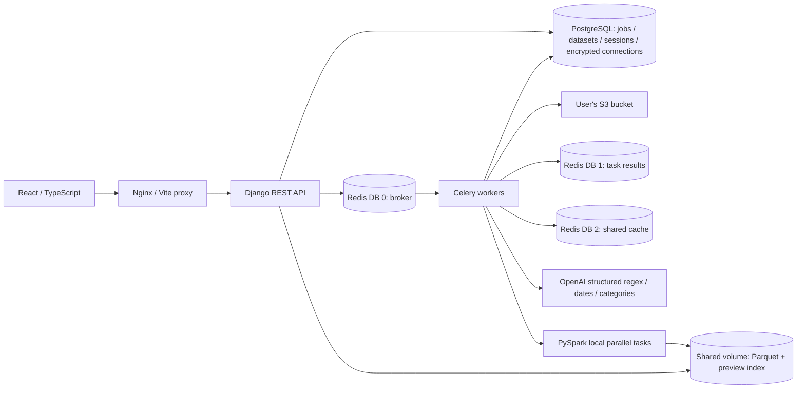

# Patternworks

A technical assessment project for natural-language tabular transformations, built with React, Django, Celery, Redis and PySpark.

**Public demo:** <https://patternworks.32-237-44-97.nip.io/> — reviewer credentials are shared privately.

**Source:** <https://github.com/LYQ1657645/patternworks> (private; reviewers need repository access).

**Demo video:** recording and README embedding are pending.

Patternworks turns a plain-language request into a validated regex, previews its effect, and applies it to a new dataset version. It also provides LLM-assisted date normalization and classification. Your source S3 objects stay unchanged.

## User workflow

1. **Sources:** connect a read-only S3 bucket, choose CSV or Excel, select an automatically discovered worksheet, and import. An unexpired connection survives refresh; Disconnect returns to the connection form.
2. **Datasets:** select a file constellation, then a planet to view that version. Equal-content versions within a source family share one planet; Tasks retains every execution. Original imports and transformation results retain their actual lineage.
3. **Transform:** choose columns and describe a regex match, review the preview, then Apply to save a separate result. Dates, categories and literal text replacement are also available. Changing inputs invalidates the previous preview.
4. **Download:** open a result and Export CSV. Tasks shows progress, cancellation, failures and eligible retries. Manage provides dependency-safe Trash, restore and optional retention; source S3 files remain unchanged.

Planet texture identifies a file family; color identifies the operation. Slow animation can be disabled. Data preview, transformation and export use persisted datasets, independent of the decorative scene.

## Verification and scale

- [Latest release audit](docs/PLANET_RELEASE_ACCEPTANCE_2026-10-21.md) records the current publication state and workflow checks.
- [Million-row server acceptance](docs/ASYNC_WORKSHEETS_AND_REGEX_ACCEPTANCE_2026-10-20.md) and its [raw measurements](docs/million-acceptance-20261020.json) cover a synthetic 1,000,000-row CSV through real Spark import, regex, cached date normalization and cached classification, with exact cell checks. These are single-host measurements; S3 transport and live model calls were excluded from that benchmark. Million-row Excel and high-cardinality model inference have not been established.
- [Recovery acceptance](docs/DAY5_ACCEPTANCE.md) records cancellation, worker crash recovery and manual retries; [lifecycle acceptance](docs/DATASET_LIFECYCLE_ACCEPTANCE.md) covers deletion and retention.
- Dated reports describe the implementation at the time of each run; their timings and test counts are not claims of a fresh run for every release.
- The 2026-10-21 release passed 77 frontend tests and 368 backend tests, including 12 real Spark integrations. Public Safari acceptance covered a renewed S3 connection, Excel worksheet discovery/import, Chinese email matching across two columns, Apply and an actual CSV download with all 48 data cells checked independently.

## Run with Docker Compose

Prerequisites: Docker Desktop with Compose, and Python 3 for generating local settings. Node and Python dependencies run inside the containers.

```bash
python3 scripts/init_env.py
# Edit .env.local privately and set OPENAI_API_KEY before using LLM transformations.
docker compose --env-file .env.local up --build -d
```

- Application: <http://localhost:5173>
- Worker monitoring (local only): <http://localhost:5555>
- Run `python3 scripts/smoke_async.py` to test the actual API → Redis → Celery → database/cache path.

The initialization command preserves populated settings, including an existing `OPENAI_API_KEY`. `.env.local` is ignored by Git, excluded from Docker build contexts, and created with owner-only permissions. Do not print it or paste it into issue reports. It is read by backend services, never bundled into the frontend.

```bash
# Inspect service state and validate configuration without printing resolved secrets.
docker compose --env-file .env.local ps
docker compose --env-file .env.local config --quiet

# Tests and a real asynchronous HTTP smoke check.
docker compose --env-file .env.local run --rm backend python -m pytest -c /app/pytest.ini /app/backend/tests -q
python3 scripts/smoke_async.py

# Stop services while retaining the database and Redis volumes.
docker compose --env-file .env.local down
```

This default Compose setup is for local development. The production overlay and HTTPS setup instructions are in [deployment guide](docs/DEPLOYMENT.md); the running AWS endpoint and verified checks are recorded in [deployment acceptance](docs/DEPLOYMENT_ACCEPTANCE.md). PostgreSQL and Redis are on the internal Compose network; the local web interface and Flower bind to loopback only. Flower must remain private when the application is deployed.

## Connect your S3 bucket

1. Prepare a test bucket containing at least one CSV and one Excel file.
2. Use credentials with `s3:ListBucket` and `s3:GetBucketLocation` for that bucket, plus `s3:GetObject` for its objects.
3. Enter the bucket name, Access Key ID, Secret Access Key and optionally a region in the app. Temporary AWS credentials are supported through the optional session-token field.
4. Submit the connection, watch the asynchronous task finish, select a CSV or Excel file, then click **Import file**. Selecting Excel queues a background task to read worksheet names from S3, shows progress/cancel controls, and selects the first tab automatically. Choose another tab from the dropdown before importing; a failed lookup offers Reload worksheets. CSV does not need a worksheet selection. Recent datasets and unexpired connections are restored after a page refresh in the same browser session.

There is no preconfigured bucket or hardcoded AWS credential. Only standard AWS endpoints are used; custom S3-compatible endpoint URLs are outside the assessment scope. An S3 `403` cannot always distinguish a bad credential from missing permissions, so the UI asks users to check both.

The AWS credential payload is encrypted with Fernet before database persistence. The encryption key is a server environment secret separate from the database. Queue messages carry only job IDs. Credentials are not returned by API serializers and are cleared from the form once a job is accepted. Connections expire after one hour; expired credentials are refused immediately and the cleanup service checks for expired ciphertext every 15 seconds. Browser sessions scope access to jobs and connections; this is session isolation, not a complete account system. Server-side session loading validates expiry/deletion before determining data ownership. Invalid sessions receive a fresh anonymous identity and cannot access the old identity's records; retained data is neither deleted nor reassigned. Clearing/losing a browser session does not provide account-style data recovery.

## Architecture



- `backend/config/`: Django settings and Celery configuration.
- `backend/processing/views.py`: request validation, session isolation and lightweight API operations.
- `backend/processing/tasks.py`: background execution and task-state transitions.
- `backend/processing/services/`: credential handling, S3 access and queue submission.
- `frontend/src/`: connection form, file browser, dataset preview/replacement and job polling.
- `scripts/`: initialization and explicit verification commands.
- `docs/PLANET_RELEASE_ACCEPTANCE_2026-10-21.md`: latest release evidence; `docs/STATUS.md` indexes historical milestones.

PostgreSQL is the application source of truth for job state. Redis is not used to store complete datasets. Redis uses separate logical databases for broker, results and cache; they share one Redis server and therefore one resource/failure boundary. Dataset pagination uses persisted, indexed SQLite row artifacts alongside canonical Parquet; it never starts Spark or recomputes transformations for a page request. SQLite here is a read-only preview artifact, not the application database (PostgreSQL).

Job submission persists the record before publishing the opaque job ID. Unclaimed publishing failures persist `FAILED` and return HTTP 503; a lost producer acknowledgement cannot overwrite an already claimed/completed task. Workers conditionally claim `QUEUED` jobs with a fresh attempt token. All progress, artifact publication and completion are fenced to that token, so duplicate/stale processes cannot publish over or delete a newer attempt. Transient S3/model failures retry at most twice with backoff; permanent errors fail directly.

Each active attempt checks status once per second and heartbeats every five seconds. Cancellation interrupts its Spark job group and fences result publication; checks also run between streaming/model stages. In-flight network/model calls may still finish, and model calls may still be billed. Cancelling an import preserves its reusable S3 connection. Parsing/indexing row-progress updates are limited to twice per second to avoid thousands of database writes.

The cleanup service reconciles jobs every 15 seconds. A running job with no heartbeat for 90 seconds is fenced out, its unpublished output/staging cleaned, and the same job requeued at most twice. Queued records missing delivery are republished after five minutes; waiting in a healthy backlog does not exhaust the recovery budget. This is reconciliation rather than a transactional outbox. Redis uses late acknowledgements/worker-loss rejection; database claims protect duplicate deliveries. An external provider call interrupted before caching can be billed again after retry. The Redis/Flower task result may be SUCCESS for a handled business failure or skipped duplicate; the frontend uses the durable database job API.

Failed/cancelled tasks can be retried as a **new task**, retaining the original audit record and creating a separate output dataset. Expired/erased S3 credentials require reconnecting. See the Day 5 acceptance report for actual cancellation, hard-worker-crash and Redis-outage tests.

## API

All mutation endpoints require a session cookie and a CSRF token. Obtain them from `GET /api/session/` and send `X-CSRFToken` for POST requests.

| Method | Endpoint | Behavior |
| --- | --- | --- |
| GET | `/api/session/` | Establish browser session and obtain CSRF token |
| GET | `/api/health/` | Database/Redis readiness and OpenAI configuration presence (not live validation) |
| POST | `/api/diagnostics/` | Submit real cache/worker diagnostic; returns 202 and job ID |
| GET | `/api/connections/` | Restore only owned, unexpired connection metadata; never credentials |
| POST | `/api/connections/` | Encrypt user-supplied credentials and submit S3 access check; returns 202 |
| GET | `/api/connections/{id}/files/?prefix=&cursor=` | Bounded file listing with S3 continuation token |
| POST | `/api/connections/{id}/worksheets/` | Queue worksheet discovery with `{ "key": "file.xlsx" }`; returns 202/job, poll `/api/jobs/{id}/` for ordered names; session-owned, live connection required |
| GET | `/api/jobs/?cursor=&limit=10&status=&kind=` | Session-owned task history with signed keyset cursor; startup uses limit=1 |
| GET | `/api/jobs/{id}/` | Persisted job state, progress and sanitized result/errors |
| POST | `/api/jobs/{id}/cancel/` | Cooperative cancellation of a queued/running job |
| POST | `/api/jobs/{id}/retry/` | Retry a FAILED/CANCELLED job with new job/result IDs; connection checks require credential re-entry |
| POST | `/api/datasets/` | Submit ingestion with `connection_id`, S3 `key`, optional `sheet_name`; returns 202 |
| GET | `/api/datasets/?cursor=&limit=25&status=&q=&scope=ACTIVE&parent_id=` | Paginated session-owned datasets; name/UUID search, ACTIVE/TRASH/ALL location and direct-child filter; PURGED excluded |
| GET | `/api/datasets/{id}/lineage/?limit=200` | Session-owned saved version graph, actual parent edges; bounded 50–500 nodes |
| GET | `/api/datasets/galaxy/` | Whole-library star map with search, lifecycle/status filters and signed cursor pagination (up to 100 records per page) |
| GET | `/api/datasets/{id}/` | Dataset status, schema, row count and source/Spark metadata |
| GET | `/api/datasets/{id}/lifecycle/` | Dependencies, blockers, policy/deadline and signed five-minute review |
| POST | `/api/datasets/{id}/trash/` | Complete `confirm_id`, `review_token`, plus `confirm_original` for imports; seven-day recovery, no cascade |
| POST | `/api/datasets/{id}/restore/` | Restore before deadline, parent first; resets policy to Keep |
| POST | `/api/datasets/{id}/retention/` | `days`: 0/7/30/90; nonzero needs `confirm_expiry`, processed datasets only |
| GET | `/api/datasets/{id}/rows/?after=0&limit=25` | Stable row-number cursor pagination; maximum 100 rows |
| GET / POST | `/api/datasets/{id}/export/` | Restore export status / prepare full CSV asynchronously (reuses active or available completed exports) |
| GET | `/api/jobs/{id}/download/` | Session-owned completed CSV attachment; original row order, all columns/full values |
| POST | `/api/datasets/{id}/replace/` | Submit literal replacement with column key, `find`, `replacement`; new dataset |
| POST | `/api/datasets/{id}/rules/` | Submit natural-language rule generation with `columns` (or legacy `column`), `instruction`, and optional literal `replacement`; returns 202 |
| GET | `/api/datasets/{id}/rules/` | Recent 10 session-owned rules for a dataset |
| GET | `/api/rules/{id}/` | Persisted validation result, pattern, local preview and cache metadata |
| POST | `/api/rules/{id}/apply/` | Apply a READY rule to a new dataset in Spark; returns 202 |
| POST | `/api/datasets/{id}/transformations/` | Preview DATE or CATEGORY with `column`, `instruction`, `options`, `allow_send_values=true`; returns 202 |
| GET | `/api/datasets/{id}/transformations/` | Recent 10 session-owned transformation previews |
| GET | `/api/transformations/{id}/` | Persisted preview, configuration, pinned model and cache/token usage |
| POST | `/api/transformations/{id}/apply/` | Apply a READY preview with `allow_send_values=true` to a new dataset; returns 202 |

S3 listing fetches at most 100 objects per request, filters CSV/XLSX/XLS and preserves continuation tokens even if a page contains no supported files. All downloading, parsing, Spark processing and artifact creation run in Celery. Progress represents stages, with row counts shown during parsing/indexing; it is not a measured fraction of all computation.

## Dataset processing and limits

1. The worker streams S3 bytes to a private temporary file. User credentials are used only by boto3 and are never placed in Spark configuration, file paths or queue messages.
2. A streaming parser validates the header/row widths and writes normalized JSON lines with stable row IDs. CSV uses Python's strict CSV reader; XLSX uses openpyxl read-only mode; legacy XLS uses xlrd on-demand sheets.
3. PySpark loads an explicit schema (text columns plus an internal row ID), repartitions the DataFrame and writes Parquet. Preview artifacts are built from that persisted Spark output through temporary partitioned JSON, using bounded SQLite insert batches. No full-dataset `collect()` or pandas DataFrame is used.
4. The API returns bounded pages from an indexed, read-only SQLite artifact, ordered by source row number. It does not read Parquet or invoke Java during pagination.
5. **Replace text** executes Spark `regexp_replace` with the find text and replacement escaped as literals. It creates a separate dataset and leaves the original intact. The natural-language regex workflow below adds validated RE2 replacement without executing model output as Java regex or code.

Imports keep values as text to preserve identifiers such as `001` and mixed-format date strings. Native Excel date-only cells become YYYY-MM-DD based on cell formatting; real timestamps (including midnight timestamps) retain their time. Re-import older native-date workbooks to recover this distinction; Excel numeric display formatting (for example, formatted leading zeros on numeric cells) is not reproduced. Store identifiers as text when their formatting matters. Empty cells become null; wholly empty rows are skipped. Blank/duplicate headers receive unique display names and safe internal column keys. UTF-8 (including BOM), comma-separated CSV and quoted multiline fields are supported; other encodings are rejected. Export other delimiters to comma-separated CSV before importing. XLSX formulas are rejected: export a values-only copy first. Legacy XLS returns stored/cached values; it does not recalculate formulas.

Default limits: CSV 1 GiB, Excel 100 MiB, expanded XLSX 512 MiB, 256 columns, 65,536 characters per cell. Preview cells show at most 4,096 characters while full values remain in Parquet. Page responses also stop near a 2 MiB row-payload budget (one wide row may exceed that budget); follow the returned cursor rather than assuming every page contains the requested number of rows. Header-only files are valid empty datasets. Use a header in the first row of the selected sheet. Multi-sheet workbooks are imported one selected sheet at a time, not silently merged.

The supplied Compose configuration runs PySpark 4.0.3 with Java 21 in `local[2]` mode, four output partitions and one Celery execution slot to bound memory. This is a single-machine parallel Spark setup, not an external Spark cluster. Shared dataset storage is a named Docker volume; it survives container restarts. Cross-host deployment needs shared/object artifact storage and compatible Spark driver/executor configuration. One-million-row CSV correctness/performance evidence is recorded in `docs/DAY5_ACCEPTANCE.md`. Date/category scale measurements use a preseeded validated fixture cache, excluding model/network latency. Datasets default to Keep; processed datasets may opt into 7/30/90-day expiry followed by seven-day recoverable Trash and dependency-safe automatic local cleanup. Original imports never expire automatically, and S3 objects are unchanged. See [lifecycle acceptance](docs/DATASET_LIFECYCLE_ACCEPTANCE.md).

## Natural-language regex workflow

The same pattern and literal replacement apply to all selected columns in one asynchronous task and one new dataset. Each column has a preview; unchanged instructions reuse the same cached pattern across different selections. Any selected-cell failure prevents publishing a partial result. Overall matched/changed rows count a row once, while matched cells and occurrence counts include all selected columns; the result also shows per-column counts. Legacy single-column requests and historical rules remain supported.

1. Open a dataset and select one or more **Target columns**. Describe the pattern, for example: `Find all email addresses in this column.` Enter **Replacement value** separately, for example `[EMAIL]`. This field takes priority over any replacement mentioned in the instruction; an empty field deletes matches. Spaces, Unicode, dollar signs and backslashes are literal.
2. Click **Generate**. The API persists a job immediately; Celery checks Redis, or calls OpenAI Responses with a strict JSON schema, `store=False`, a bounded timeout and bounded output. Model access errors, quota failures and transient provider errors have separate safe messages; transient errors retry at most twice.
3. A generated rule must pass schema, RE2 compilation and policy validation before publication or caching. The user-specified replacement is applied locally to the preview and saved rule, rather than sent to the model. Changing only this value reuses the validated pattern cache. Review the updated preview before applying; editing the prompt, target column selection or replacement disables applying a stale preview. The UI shows the pattern, literal replacement, explanation, cache hit/miss, and before/after examples.
4. Click **Apply** after reviewing it. Spark processes the selected columns through one partition-executed RE2 array UDF per row, persists one new Parquet dataset and returns a paginated preview with exact global and per-column counts. Nulls, unmatched values and unselected columns are preserved. The source dataset is retained.

For this regex workflow, only the user's instruction, fixed system instructions and the response schema are sent to OpenAI. The separate replacement field, dataset rows, S3 credentials, bucket details and dataset paths are not sent. Do not put credentials into the instruction field. Local before/after previews compute on at most 20 complete source values (display five), and only the displayed strings are clipped to 4,096 characters; they are not full-dataset match counts. Final Spark counts use the full values in Parquet. Generated matching/non-matching examples are checked locally, and exact numeric-length requests receive longer-number counterchecks. These checks do not prove every aspect of intent; inspect your preview before applying.

The supported regex dialect is **RE2**, executed by the official `google-re2` binding. There is no Java/Python backtracking-regex fallback for AI rules. Patterns are capped at 512 characters, literal replacements at 256 and transformed cells at 65,536. The policy rejects invalid syntax, lookarounds, backreferences, inline flags, excessive group nesting, nested/chained repetition, byte matching/quoted blocks and empty matches. Case-insensitivity uses a separate boolean. Replacement strings are literal: `$1` and backslashes are never expanded. Capture-based extraction/reordering and arbitrary model-generated code are outside this milestone. Practical email matching does not constitute complete RFC email validation.

For regex generation, Redis DB 2 caches only successfully validated rule output, not dataset rows or credentials. Keys hash the browser-session owner, NFC-normalized instruction (outer whitespace trimmed; case and inner whitespace retained), configured model, prompt version and validation policy version. Default TTL is one hour (`RULE_CACHE_TTL_SECONDS`). Cache hits are validated again and avoid a model call; invalid cached entries are discarded. Rules, previews and task state are persisted in PostgreSQL and scoped to the browser session. Cache unavailability fails explicitly instead of silently making an uncached paid call. The supplied single execution slot serializes generation requests; a multi-worker deployment would need request coalescing to avoid simultaneous cache-miss duplicates.

Generation cancellation discards publication and never deletes the source dataset. A model request already in flight may still complete and be billed. Spark job-group cancellation and fenced worker recovery are implemented; interruption latency depends on the running action and cleanup.

The core lock and small `requirements-rules.lock` are installed together. The separate Docker dependency layer keeps the existing Spark installation reusable while adding the native RE2 wheel. Both locks must be included in non-Docker installs.

## LLM dates and categories

1. In **Dates & categories**, choose **Normalize dates** or **Classify values**, then the source column.
2. For dates, choose how to handle ambiguous `03/04/2026`: flag it, day first, or month first. Output is ISO `YYYY-MM-DD`. Supported date-only inputs have a four-digit year: numeric year-first formats, numeric day/month or month/day formats, English month names and Chinese year/month/day. Gregorian dates (including leap years) are checked independently of the model. Missing years, relative dates, timestamps, serial numbers and unknown formats are not guessed.
3. For classification, enter 2–12 unique labels, up to 40 characters each, choose one fallback label, and describe the classification criteria. Model output must use an allowed label. Uncertain input uses the fallback. Label membership validation does not establish semantic accuracy: review the results.
4. Confirm **I agree to send selected-column values to OpenAI**. Unlike regex generation, these tools send actual selected values, guidance and options to OpenAI. They do not send other columns, bucket/path metadata or AWS credentials. Preview processes the first 20 rows and shows up to ten before/after examples; it is not a full-column accuracy or performance test.
5. Review the preview and click **Apply to full column**. Spark profiles the full column, obtains a bounded distinct-value set, and joins validated LLM results across partitions. All existing columns and row IDs are preserved in a new dataset. Two columns are appended with unique display names: the normalized/classified value and its status.

Date statuses: `normalized`, `invalid`, `ambiguous`, `missing`. Invalid/ambiguous/missing dates have null result cells; original strings remain in their source column. Classification statuses: `classified`, `fallback`, `missing`. Missing input remains null. Counts displayed on result datasets are calculated over the full column.

The compact version allows **500 distinct non-null values per column**, each at most **1,024 characters**, with batches of at most 12 distinct nonblank values. Blank strings are handled locally. Full-column length/cardinality preflight happens before new apply-stage model calls; preview calls may already have been billed. Oversized/high-cardinality columns fail explicitly, without silently truncating or processing only a prefix. This supports many repeated values across large datasets, not unrestricted high-cardinality LLM processing.

Validated per-value results are cached in Redis DB 2 for one hour. Keys hash owner session, transformation kind, guidance, options/labels, pinned model, policy version and the exact value. Payloads contain only the converted value/label and status, which may still be sensitive data. Source strings are not stored in plaintext cache keys. PostgreSQL stores the configuration and bounded preview; complete results remain in Parquet/preview artifacts. Cached values are revalidated before reuse, and preview/application share them. The model is pinned when the preview is submitted; changing the server default does not silently change an existing transformation.

OpenAI requests run sequentially in the Celery driver, never in Spark executor UDFs. Spark executor retries therefore cannot duplicate model calls. Completed batches are cached before subsequent batches so transient job retries can reuse them while the entries remain valid. There are at most two transient retries; provider SDK retries are disabled. Cancellation is checked before/after each batch and actively interrupts Spark actions. An in-flight request can still be billed; durable provider checkpoints after cache expiry and multi-worker cache-miss coalescing remain pending.

## Local checks without Docker

Use Python 3.12+, Java 17/21 (Java 21 is used in Docker), and Node 22+. Docker is still required to verify the intended PostgreSQL/Compose stack.

```bash
python3.12 -m venv .venv
.venv/bin/python -m pip install -r backend/requirements.lock -r backend/requirements-rules.lock
.venv/bin/python scripts/init_env.py
.venv/bin/python -m pytest -q
.venv/bin/python backend/manage.py check --settings=config.test_settings

cd frontend
corepack enable
corepack prepare pnpm@11.25.0 --activate
pnpm install --frozen-lockfile
pnpm test
pnpm build
cd ..
```

For a local preview, `scripts/dev_local.py` runs a real Redis server and a separate Celery process, but explicitly uses SQLite instead of PostgreSQL. It requires an installed `redis-server` or the temporary project-local binary used during setup. On this Mac it can use Codex's bundled Node; normal machines should install Node. It is a development helper, not a substitute for Compose acceptance.

```bash
.venv/bin/python scripts/dev_local.py
# In a second terminal:
.venv/bin/python scripts/smoke_async.py --url http://127.0.0.1:5173
```

API availability can optionally be checked with `.venv/bin/python scripts/check_openai.py`. This makes one small, billed API request, sends no S3 credential or file, and does not print secrets. Creating a key does not establish billing or quota availability. The selected model is configurable through `OPENAI_MODEL`; it is not hardcoded in the transformation UI.

## Repository and delivery

This repository contains the application, migrations, dependency locks, Docker/HTTPS configuration, CI checks, synthetic fixtures, reproducible verification scripts and dated acceptance reports. Local credentials, private SSH keys, databases, downloaded user data, dependency caches and build output are excluded. Both environment example files contain placeholders only. Run `python3 scripts/check_repository.py` before committing, or use `--staged` to inspect exactly the staged blobs; it reports file/rule locations without printing secret values.

GitHub Actions runs backend/Spark tests, Django and Compose checks, frontend tests/build, and the repository secret check. A green workflow establishes automated checks; real S3/model, public browser and million-row measurements have separate acceptance reports.

The public application is deployed. Reviewers require the privately supplied demo login and access to this private repository. The final demonstration video still needs to be recorded and embedded above; it should show user-entered S3 credentials and an asynchronous task reaching completion.

Third-party component notices and their original license are retained in [React Bits sources](frontend/src/vendor/react-bits/README.md). An author-wide open-source license has not been assigned to this assessment repository.

## Technical references

- [OpenAI quickstart](https://developers.openai.com/api/docs/quickstart)
- [Celery and Django](https://docs.celeryq.dev/en/stable/django/first-steps-with-django.html)
- [S3 ListObjectsV2](https://docs.aws.amazon.com/boto3/latest/reference/services/s3/client/list_objects_v2.html)
- [Spark cluster overview](https://spark.apache.org/docs/latest/cluster-overview.html)

- [PySpark 4.0.3 installation and Java requirements](https://spark.apache.org/docs/4.0.3/api/python/getting_started/install.html)
- [openpyxl read-only mode](https://openpyxl.readthedocs.io/en/stable/optimized.html)

- [OpenAI structured outputs](https://developers.openai.com/api/docs/guides/structured-outputs?api-mode=responses)
- [RE2 guarantees and supported syntax](https://github.com/google/re2)

## Workspace behavior

Use **Sources**, **Datasets** and **Transform** to follow the workflow; **Tasks** opens execution history. Source files/worksheets form constellations, distinct saved contents are planets, and actual parent transformations are clickable paths. Click a constellation to move the camera closer, then a planet to view its data. Identical-content versions within a file family share one displayed planet while Tasks retains each execution. Failed or pending attempts remain distinct from successful saved results. **Search** opens file search, lifecycle/status filters and an accessible version list. The map pages through up to 100 records at a time, with bounded family history. No parent link is invented when its endpoint is outside the current page.

The data preview provides **Transform**, **Export CSV** and **Manage** (delete, retention and restore). Close it to return to the same scene. Select a path to inspect the operation and before/after samples. **Tasks** includes failures, cancellation, retry and exports. Generate saves a rule and preview; only successful Apply creates a data version. Tools retain drafts while switching pages; full reloads do not preserve unsaved drafts. The 3D module loads only on the dataset page; unavailable WebGL falls back to the searchable version list, and reduced motion disables planet rotation and path particles.

### Usability update (2026-10-19)

- Excel worksheet dropdown reads actual tab names and defaults to the first. Lookup is read-only, bounded by the existing source/expanded-workbook limits, and runs as a durable LIST_WORKSHEETS Celery job without creating a dataset. XLSX tab discovery reads workbook metadata without loading cell/shared-string data. Pending duplicate requests reuse the same job; polling reconnects to that job after a network interruption. Cancellation, transient retries and worker-loss recovery use the shared job lifecycle. Import remains a separate asynchronous task.
- New regex, date/category and exact-text forms require an explicit column selection instead of silently choosing ID. Existing saved previews retain their explicit selections. Switching date/category modes clears the selection; identifier-like column names show a warning.
- Classification requires user-provided labels and a matching fallback before preview; example labels are placeholders only.
- Result summaries show operation/time, status counts and the appended result/status column names, with a button to scroll directly to them. Original values are preserved. Non-success statuses are visible outside Technical details.
- Permanent import input errors (including missing worksheets) explain how to correct the source instead of offering an identical retry. Cancelled tasks and transient failures retain retry behavior.
- Import errors no longer also appear inside the successful S3 connection box.

This improves the current single-browser-session workflow. Team accounts/sharing, automatic column-type inference, editable data grids and byte-range-resumable workbook downloads are separate product extensions, not claimed as implemented.
