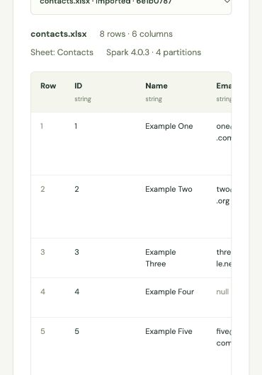

# Day 2 acceptance — 2026-10-17 (Melbourne)

Day 1 is complete for the agreed local foundation: Docker services, PostgreSQL/Redis, real Celery execution, session-isolated/encrypted S3 access, live file listing and Flower availability passed. This is milestone acceptance, not final assessment acceptance or public deployment.

## Automated checks

- Full container test suite: **62 passed**, including real JVM/PySpark tests (final clean run: 13.83 seconds).
- Coverage includes CSV BOM/quoting/multiline fields/leading zeros, malformed files, duplicate headers, XLSX worksheets/dates/formulas/limits, empty datasets, stable pagination, page byte limits, session isolation, cancellation and source preservation.
- Real Spark tests import both fixtures, persist Parquet, read cursor pages, test literal regex/replacement metacharacters, and verify header-only datasets.
- Django checks and migration consistency passed; TypeScript/Vite production build passed. Flower showed one online worker in its browser dashboard.
- Tests use isolated temporary artifacts and a test database. They do not replace the live S3/PostgreSQL checks below.

## Live S3 → Celery → Spark → preview

Bucket: `patternworks-test-20261017-k7m3`, region: `ap-southeast-2`. The browser restored the existing session's unexpired connection without re-entering credentials.

| Operation | Dataset ID | Rows / columns | Parquet partitions | Worker duration |
| --- | --- | --- | --- | --- |
| CSV import | `56c32243-68e9-4eff-8b29-cb61c0ef3012` | 8 / 6 | 4 | 18.383 s |
| XLSX import, sheet `Contacts` | `6e1b0787-2393-4231-b487-0c2e283b46a9` | 8 / 6 | 4 | 3.779 s |
| Literal Country replacement, `USA` → `United States` | `2c6fce01-1b13-48c1-9175-93f33ddea858` | 8 / 6 | 4 | 4.277 s |

All three tasks reached `SUCCESS` / 100%, and their datasets reached `READY`. Spark version was 4.0.3, Java 21, local parallel execution (`local[2]`). The first import includes cold Spark startup. These eight-row timings are smoke checks, not scalability measurements.

An independent read of the persisted preview artifacts confirmed:

- CSV and XLSX rows both exactly match the local synthetic CSV fixture, including null email, commas and original date strings.
- Reading each artifact with `limit=3` returns pages of **3, 3, 2** rows, in order 1–8, with no missing or repeated rows.
- Replacement changes the two `USA` values; the original XLSX artifact still exactly matches its input.
- Each artifact contains four actual Parquet partition files. The same content/pagination checks passed after rebuilding and restarting all application containers, verifying shared-volume persistence.
- Source-row SHA-256 (JSON with sorted keys): `5daef58e30b7e3a496ff2642b77c113b206b775f0842f204f46b68331f6950f1`.

The verification reads job/dataset metadata and synthetic rows only. It does not read or print stored credentials. The AWS bucket is unchanged; transformed datasets are local artifacts.

## Remaining scope

- Natural-language regex generation, rule validation/cache and two additional LLM transformations.
- Immediate Spark interruption and recovery of abandoned jobs.
- Million-row performance/correctness evidence and artifact retention/cleanup.
- Public HTTPS deployment, GitHub submission and demonstration video.
- Legacy XLS parsing is implemented via xlrd; the live bucket and real Spark fixtures above cover CSV/XLSX, not a legacy XLS workbook.
