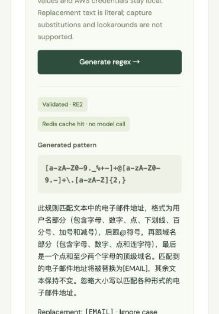
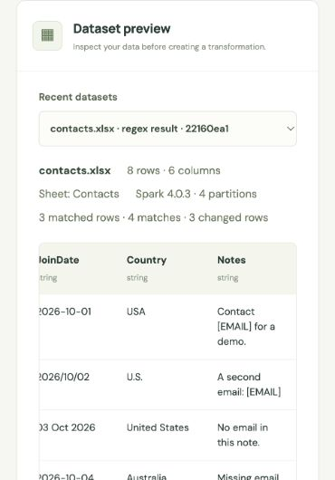

# Day 3 regex / validation / cache acceptance — 2026-10-17

The natural-language regex milestone is implemented and locally verified. Public deployment is still pending; this record does not claim final assessment completion.

## Implemented

- Session-owned, persisted `GENERATE_RULE` and `APPLY_RULE` jobs, immediate HTTP 202 submission and progress polling.
- OpenAI Responses structured JSON generation using the previously configured `gpt-4.1-mini` project key. The user instruction is the only user-supplied content sent to the model; dataset cells, AWS credentials, bucket metadata and paths are excluded.
- Strict output/schema checks, RE2 compilation, pattern/cell size limits, and rejection of nested/chained repetition, empty matches, unsupported lookarounds/backreferences/inline flags and excessive group depth.
- One RE2 implementation for bounded local previews and Spark partition execution; replacement text is always literal.
- Explicit generate → inspect → apply workflow. Applying a rule creates a new dataset, preserves source artifacts/nulls/other columns and records full-data match statistics.
- Redis caching of validated rules with session/model/prompt/policy-scoped hashed keys and a one-hour TTL. Cache hits are validated again; malformed entries are discarded. Cache data contains no dataset previews or credentials.
- Bounded provider requests, sanitized error categories, at most two transient retries, cancellation without source deletion, and task/rule restoration after browser refresh.

## Automated evidence

- **115 container tests passed** in 27.49 seconds, including three real JVM/Spark integration tests.
- **112 non-Spark tests passed** locally.
- Real Spark RE2 test compares local preview semantics with persisted output, checks literal `$1`/backslash handling, 3 matched rows / 4 matches, unchanged columns/nulls/source, and rejection of a stored invalid rule before execution.
- Unit/API coverage includes unsupported/model-malformed output, authentication/quota errors, invalid/corrupt cache entries, cache owner/model/instruction isolation, cache availability, cancellation during generation, source preservation, CSRF and cross-session denial.
- TypeScript/Vite production build, Django checks and migration consistency passed.
- Final restart check exposed a stale Nginx upstream address after backend replacement. The frontend now resolves the backend through Docker DNS with a five-second cache. Nginx configuration validation and the real HTTP → broker → worker → Redis smoke check passed before and after independently recreating the backend, without restarting the frontend. The recreated backend received the same IP in this final check; a forced different-IP failover was not separately tested.
- Browser refresh restored the successful regex transformation and its full-data counts. Persisted source/result verification also passed after rebuilding the application containers.

## Real OpenAI + Redis + Spark evidence

Source dataset: `6e1b0787-2393-4231-b487-0c2e283b46a9`, imported Excel sheet `Contacts`, eight synthetic rows and six columns. Target column: `Notes` (`c5`).

Instruction:

> 把这一列中所有电子邮件地址替换为 [EMAIL]，其余文字不变。

The real model produced this validated RE2 pattern, literal replacement `[EMAIL]`, and `ignore_case=true`:

```regex
[a-zA-Z0-9._%+-]+@[a-zA-Z0-9.-]+\.[a-zA-Z]{2,}
```

| Check | Observed result |
| --- | --- |
| First generation job | `d7318386-5f59-4211-8876-f920e7318122`, SUCCESS |
| First rule | `f012ea2c-8d26-4a7c-b621-b476d4dc8c7d`, READY, cache miss |
| Real provider usage | 348 input tokens, 166 output tokens |
| Cache persistence | Worker was restarted after first generation; ping confirmed it online |
| Repeated generation job | `325024b1-a9f7-4263-9515-a805f4b71fef`, SUCCESS |
| Cached rule | `099bf82c-7def-4a0f-9476-81650a6c56c0`, READY, cache hit |
| Cache-hit provider usage | 0 input / 0 output tokens; no model call |
| Physical Redis entry | Positive TTL observed (3214 seconds at independent check); payload contains rule fields only |
| Apply job | `ec54afbc-b35f-4669-bec4-e8d207a96fde`, SUCCESS, 8.557 seconds of worker execution |
| Result dataset | `22160ea1-37c3-4463-9558-a44f5416352d`, eight rows, six columns, four Parquet partitions |
| Full-data match counts | Three matched rows, four email matches, three changed rows |

Independent persisted-artifact checks compared every result cell against explicit expected fixture values. For example:

```text
Contact one@example.com for a demo.
→ Contact [EMAIL] for a demo.

Two emails: first@example.com and second@example.net
→ Two emails: [EMAIL] and [EMAIL]
```

All other columns and source rows remain identical to the original fixture. Cursor pagination returns row IDs 1–8 exactly once. All data checks use the synthetic test fixtures; no million-row performance conclusion is drawn.





## Limits and next work

- This milestone supports regex matching/preview and literal replacement, not capture-based extraction/reordering or arbitrary code. Email matching is practical rather than exhaustive RFC validation.
- Local previews use at most 20 rows / 4096 characters per source cell; full-data counts are calculated only on Spark application.
- The supplied single execution slot serializes generation. Multi-worker cache-miss coalescing remains a deployment scaling concern.
- An in-flight provider request may finish after cancellation. Immediate Spark interruption and recovery of abandoned jobs remain pending.
- Additional LLM date/category transformations, million-row validation, artifact retention, public HTTPS deployment, GitHub submission and demo video remain outstanding.

References: [OpenAI structured outputs](https://developers.openai.com/api/docs/guides/structured-outputs?api-mode=responses), [official RE2 project](https://github.com/google/re2).
