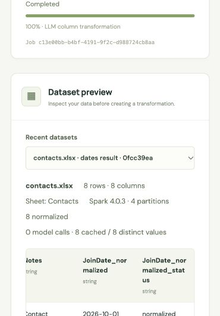
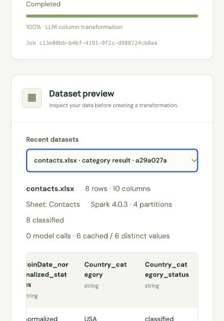

# Day 4 date normalization / classification acceptance — 2026-10-17

Both additional LLM transformations are implemented and verified locally. This record does not claim public deployment, million-row performance, or completion of the original plan's immediate Spark cancellation/abandoned-job recovery work.

## Behavior

- Choose a source column and either **Normalize dates** or **Classify values**. Explicitly confirm sending selected-column values to OpenAI. Unlike regex generation, these tools send actual selected values along with guidance/options; other columns, dataset/bucket paths and credentials are excluded.
- Preview the first 20 rows, displaying up to ten examples. Review the result/status pair, then explicitly apply to the full column. Both stages immediately return HTTP 202 plus a persisted job ID and execute in Celery.
- Dates become `YYYY-MM-DD`, with independent Gregorian-calendar validation. Ambiguous numeric dates can be flagged or interpreted as day-first/month-first. Missing years, relative dates, timestamps, Excel serials and unknown formats are not guessed. Invalid/ambiguous dates have a null result and an explicit status; original values are retained.
- Classification accepts 2–12 unique user labels and a fallback label. Structured results must cover each batch ID exactly once and use allowed labels/statuses. This validates structure and label membership, not semantic correctness.
- Full application profiles the selected column in Spark, processes a bounded distinct-value set through OpenAI and broadcast-joins the validated mapping across partitions. It appends two uniquely named result/status columns, preserves source data and creates a separate persisted dataset.
- Model requests never run in Spark executor UDFs. Redis keys scope the exact value to the owner session, transformation kind, guidance/options, pinned model and policy version. Only validated converted values/labels and statuses are cached for one hour. Cache payloads can still contain sensitive converted values; source values are not plaintext key names.
- Repeated values share cached results between preview and application. Completed batches can be reused on transient retries while cached. Cache failures do not silently trigger uncached paid calls. Provider details are sanitized; SDK retries are disabled and transient task retries are bounded to two.

## Automated evidence

- Final container suite: **168 passed in 38.71 seconds**, including five real JVM/Spark integration tests. No provider calls are made by the automated suite.
- TypeScript/Vite production build, Django system checks and migration consistency checks passed. Source scanning found zero matches for the four configured application secrets.
- Real HTTP → broker → worker → PostgreSQL/Redis smoke checks passed after rebuilding all application containers and after independently rebuilding the backend services. Final browser refresh restored the successful classification and its eight-row/ten-column result.
- Independent persisted-output verification passed again on the final backend image; all fourteen cache entries retained a positive TTL (minimum 3127 seconds at that final check). Only the two initial synthetic preview batches used OpenAI; cache/application/restart checks made no further provider calls.

The test suite covers calendar/leap-year validity, numeric ambiguity, impossible zero date components, unsupported dates, exact batch ID coverage, invalid/hallucinated dates, out-of-set labels, fallback/blank/null handling, cache scope/corruption/failure, bounded and partially cached batches, provider error sanitization, retry limits, consent/CSRF/session isolation, cancellation and source preservation.

Real Spark integration exercises the complete date → category chain, preserved source/previous output columns, explicit expected results, four output partitions, full-column length/cardinality limits before paid requests, empty/all-null datasets and apply-stage values not seen in the preview cache. Existing CSV/Excel/regex integration coverage is retained.

## Real OpenAI → Redis → Spark evidence

The source is the previously S3-imported synthetic `contacts.xlsx`, sheet `Contacts`: eight rows and six columns, dataset `6e1b0787-2393-4231-b487-0c2e283b46a9`.

| Stage | Observed result |
| --- | --- |
| Date preview | Job `7023f8e4-5911-4f62-81f1-9f32340e1efb`, SUCCESS; one real model request, 516 input / 142 output tokens |
| Date results | Job `03b9b826-c916-444e-b8d6-1c31cc40e1af`, SUCCESS; eight normalized rows; eight cache hits, zero model calls/tokens; 9.389 seconds of job execution |
| Date dataset | `0fcc39ea-2736-4e1c-a1d7-0b4352ada055`: eight rows, eight columns, four Parquet partitions |
| Classification preview | Job `280e8d59-dfb0-42f5-a73e-8b72ed653731`, SUCCESS; one real model request, 502 input / 78 output tokens; six distinct input values |
| Rebuilt-container cache check | Job `18c8e989-c8d9-475a-848b-99034a8adca7`, SUCCESS; all six distinct country values hit Redis, zero model calls/tokens; 0.139 seconds of job execution |
| Classification results | Job `c13e00bb-b4bf-4191-9f2c-d988724cb8aa`, SUCCESS; eight classified rows; all six distinct inputs cached; zero additional model calls/tokens; 15.874 seconds of job execution |
| Final dataset | `a29a027a-ee1d-41af-8da2-e7468d20b723`: eight rows, ten columns, four Parquet partitions |
| Independent cache check | Fourteen physical Redis entries; minimum observed TTL 3296 seconds; payloads contain only `value` and `status` |

Date expectations were explicitly checked against `2026-10-01` through `2026-10-08`, rather than reconstructed with the same date engine. Inputs include `2026/10/02`, `03 Oct 2026` and `06 Oct 2026`.

Classification guidance:

> 把国家名称和缩写归类：USA、U.S.、United States 都归 USA；Australia、AU、AUS 都归 Australia；其余归 Other。

Allowed labels: `USA`, `Australia`, `Other`; fallback: `Other`. The actual model output matched the independent expected mapping: four USA rows and four Australia rows. The date columns were preserved in the classified result, and every original source cell still matched the untouched local CSV fixture. Three-row cursor pages returned row IDs 1–8 exactly once.

Machine-readable check results: [day4-live-evidence.json](day4-live-evidence.json).

## Scope and limits

- Maximum 500 distinct non-null values per column, each at most 1,024 characters, in batches of at most 12 nonblank values. Full-column preflight happens before apply-stage provider calls. Preview calls may already have been billed. Oversized/high-cardinality columns fail explicitly; no partial result is published.
- These are genuine model-backed conversions/classifications with validated responses, not arbitrary model-generated code. Calendar checks intentionally restrict accepted date-only formats. Classification accuracy still depends on the model, labels and guidance.
- New outputs consume two additional columns, within the existing 256-column dataset limit. Duplicate result display names receive a numeric suffix.
- In-flight provider calls may complete and be billed after cancellation. Cached completed batches can survive cancellation/retry; publication of a cancelled job is blocked. Immediate Spark interruption, durable checkpoints after cache expiration, multi-worker request coalescing and recovery of abandoned jobs remain pending.
- Eight-row acceptance demonstrates correctness of this fixture only. Million-row performance, broad multilingual date coverage, production/public deployment, GitHub submission and the demo video remain future work.

Reference: [official OpenAI structured output documentation](https://developers.openai.com/api/docs/guides/structured-outputs?api-mode=responses).
