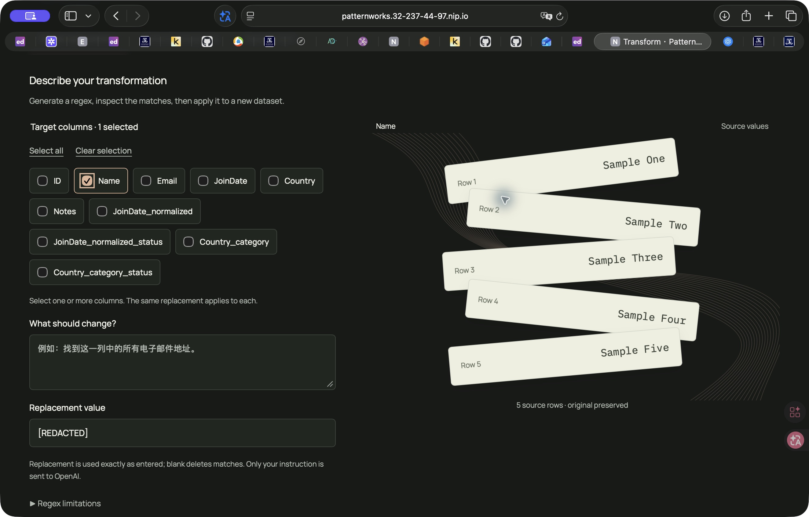

# Loom public deployment acceptance — 2026-10-20

The approved Loom frontend is deployed at [the public HTTPS application](https://patternworks.32-237-44-97.nip.io/). Reviewer authentication remains required. This supersedes the local-only delivery state in [frontend integration acceptance](LOOM_FRONTEND_ACCEPTANCE_2026-10-20.md).

## Release and rollback

45 frontend source files were transferred with a SHA-256 manifest and verified on the server. The server production build passed. Only the frontend container was replaced; backend, worker, PostgreSQL and Redis container identities and start times matched before and after release. All eight services are running; backend, PostgreSQL and Redis report healthy.

- Frontend image: `sha256:76d0488454c109205af78fe71f5066ef2faa1f0f93271ccf1421800121201988`.
- Unchanged backend/worker image: `sha256:1b3e01976e7bb22749ed24c719b51b403efad0590d4306a3e7306850d1774d24`.
- Previous frontend image is retained as `patternworks-frontend:before-loom-20261020`.
- Previous frontend source and image identity are saved on the existing server under `/home/ubuntu/loom-20261020-backup/`.
- No database migration, volume reset, Git commit or push was performed.

To roll back the frontend, tag the retained image as `patternworks-frontend:latest`, then run the existing production Compose command with `up -d --no-deps frontend`. The source backup is available separately.

## Public verification

Trusted TLS passed. Unauthenticated access returned 401; authenticated HTML, JS and CSS returned 200. Public JS/CSS bytes exactly matched the local production build. Secure cookies and CSRF protection passed; a mutation without a CSRF token returned 403. The real HTTPS → Redis → Celery → database/cache diagnostic reached SUCCESS.

The frontend's 31 tests passed again before publication. Its server TypeScript/Vite production build passed. Backend source was unchanged, so the backend suite and scale benchmark were not repeated for this release.

Safari exercised the real public application using the existing eight-row synthetic contacts fixture:

| Flow | Observed result |
| --- | --- |
| Regex | Real generation/validation, returned examples on the cards, full application SUCCESS; all persisted cells match expected replacements |
| Dates | Preview shows normalized returned dates; full application SUCCESS with 8 rows / 8 columns; all cells match expectations |
| Categories | User-defined United States/Australia/Other labels and explicit fallback; real preview groups returned labels; full result has 8 rows / 10 columns and exact expected cells |
| Preview invalidation | Editing guidance restores source cards, shows the stale notice and disables Apply |
| Text replacement | Name values change from Example to Sample in a new dataset; every persisted cell matches expectations |
| Cancellation | Text task was cancelled at the server's 60%; the task and progress display stop with CANCELLED |
| Retry | A distinct retry task reaches SUCCESS; the cancelled task remains in history |
| Export | Actual CSV progress and download availability; Safari downloaded 8 rows / 10 columns, and every downloaded cell matches expected results |
| Library/history | Library pages 1 → 2 → 1 work; new successful and cancelled tasks appear in history |
| State | Latest task and selected result restore after refresh; selected column survives normal site navigation |
| Appearance/motion | Paper/Night and Reduce motion controls work; returned data and actions remain functional with reduced motion; desktop and narrower Safari layouts inspected |

The date and category previews each made one real model call on synthetic values. Full-column processing reused their cached results. The regex generation was a real cache miss. Task IDs and usage evidence are in [the machine-readable record](loom-deployment-evidence.json).

All 36 pre-existing dataset records and their artifact file contents were unchanged after acceptance. The verification baseline stayed on the server and only the result/counts were returned. Five new synthetic dataset records were created: four successful outputs and one cancelled attempt. The original source is intact.

## Scope of remaining checks

Fresh S3 credential entry, reconnection and new CSV/XLSX imports were not repeated: the saved connection had expired and the app correctly offered the connection form. No credentials were recovered. The earlier live S3 worksheet/import acceptance remains recorded in [the prior release report](ASYNC_WORKSHEETS_AND_REGEX_ACCEPTANCE_2026-10-20.md). The full file picker and import handlers remain present. This release does not claim fresh S3 acceptance or a measured FPS result.

