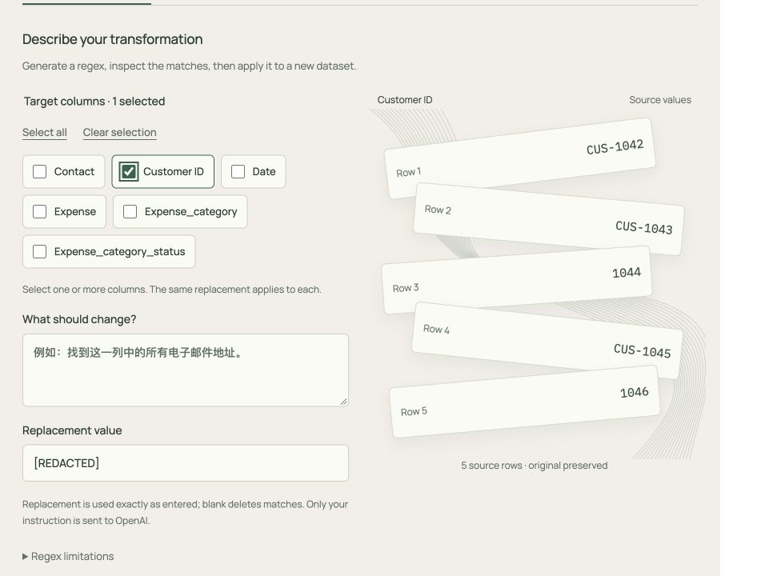

# Loom frontend integration — 2026-10-20

> Subsequently deployed and verified publicly: [Loom deployment acceptance](LOOM_DEPLOYMENT_ACCEPTANCE_2026-10-20.md). The local-only delivery state below records the earlier integration milestone.

## Delivery state

The approved Loom Motion direction is integrated into the real React frontend. This is a local source/build delivery, not a public deployment. No backend source or production data was changed. No commit or push was made.

The local acceptance app runs at `http://127.0.0.1:5173`, backed by an isolated database, dataset directory and Redis instance under `.runtime/loom-acceptance/`. Its records are synthetic acceptance data, not the production dataset library. The previous frontend source and manifests were copied to `/private/tmp/patternworks-before-loom/` before editing.

## What changed

- Paper/Night appearance, horizontal navigation, Loom typography and responsive layouts throughout Sources, Datasets, Transform and History.
- GSAP transitions for actual sampled values, returned preview results, category grouping, task progress and newly created datasets.
- React Bits Folder displays real S3 file names and invokes the existing file-selection action. The complete file list remains available. Empty input explicitly renders no example documents.
- React Bits ClickSpark decorates primary actions while preserving native buttons, disabled conditions and form submission.
- Motion preferences honor both the operating system and the in-app Reduce motion setting. GSAP effects are scoped and cleaned up; ongoing preview pulses pause when the document is hidden and stop outside the active workspace.
- Secondary explanations and technical details are collapsed; full preview rows and error details remain accessible.

## State contract

| UI behavior | Actual trigger |
| --- | --- |
| Source-value cards | First five rows of the selected column in the current dataset page |
| Aligned or grouped cards | Returned preview examples; categories use returned labels only |
| Review styling | Returned ambiguous, invalid, missing or fallback status |
| Running thread animation | The associated task is `RUNNING` and the workspace is active |
| Progress | Backend `job.progress`, bounded to 0–100; never advanced by elapsed time |
| Completed task | Backend `SUCCESS`; `RUNNING` at 100 is still running |
| Cancelled/failed task | Terminal status stops running animation and preserves reported progress |
| Result arrival | Matching successful dataset-creation job and an available, active, ready dataset |
| Download arrival | Existing export state reports a finished downloadable artifact |

Editing parameters invalidates the preview and disables Apply until the existing preview checks pass. Motion never changes stored source values. The five-row scene supplements the full preview rather than limiting processing or export.

## Verification

### Automated

- `pnpm test`: 31 passed, 0 failed (26 existing regressions plus 5 motion-state tests).
- `pnpm build`: TypeScript and Vite production build passed.
- Taste app lint: 0 failures, 4 warnings. Monospace remains for literal data/code; shadows remain on the approved floating cards and preference popover. The Taste browser inspector was unavailable, so live browser screenshots and DOM checks were used instead.

Existing regressions include navigation without unmounting drafts, dataset/history pagination, import credential expiry, worksheet polling/cancellation, explicit column selection, category validation, lifecycle changes and error handling.

### Live integration

Verified through the real browser, Django API, Redis, Celery and Spark using 30 synthetic rows:

1. Infrastructure task reached SUCCESS.
2. Regex preview removed `CUS-` from Customer ID examples. Apply created a new 30-row dataset; original values remained intact.
3. Dataset pagination reached page 2 (25 + 5 rows).
4. CSV preparation showed real progress and exposed a download link only after completion. The generated CSV was independently read: 30 data rows, 4 columns, first Customer ID `1042`, last `1046`.
5. Date preview displayed normalized results, an ambiguous date and an invalid date. Changing the date-order option invalidated the preview and disabled Apply.
6. Category preview grouped returned Software/Cloud/Other results and retained fallback flags.
7. Cancelling category processing stopped at the returned 58%. Retry created a distinct task, progressed through QUEUED/RUNNING and succeeded with a new 30-row, 6-column dataset; the cancelled record remained in history.
8. Paper/Night and Reduce motion controls worked in the live app.
9. Browser DOM checks at widths 390, 768 and 1440 reported matching document client/scroll widths. Mobile real-value cards stayed within the viewport; desktop/tablet workspaces were visually inspected.

The external model results used a preseeded Redis cache with synthetic fixtures. No new OpenAI request was made. Live AWS credential entry/S3 import and a cache-miss model request were not repeated in this acceptance run. Their existing handlers and guards remain in place; this record does not claim a fresh external-service acceptance test.

## Dependencies and provenance

- `gsap@3.13.0` and `@gsap/react@2.1.2`, with the lockfile updated.
- Official React Bits registry Folder and ClickSpark sources are vendored in `frontend/src/vendor/react-bits/`. Registry URLs, the empty-items adaptation and the upstream license are recorded there.
- Reference: [GSAP React lifecycle guidance](https://gsap.com/resources/React/) and [React Bits Folder](https://reactbits.dev/components/folder).
- Local acceptance required the existing locked PySpark 4.0.3 dependency and an official Temurin 17 JRE. Those tools and generated test datasets are local ignored artifacts, not new application source or deployment changes.

Temporary viewport HTML used for browser QA was removed before the final build.
